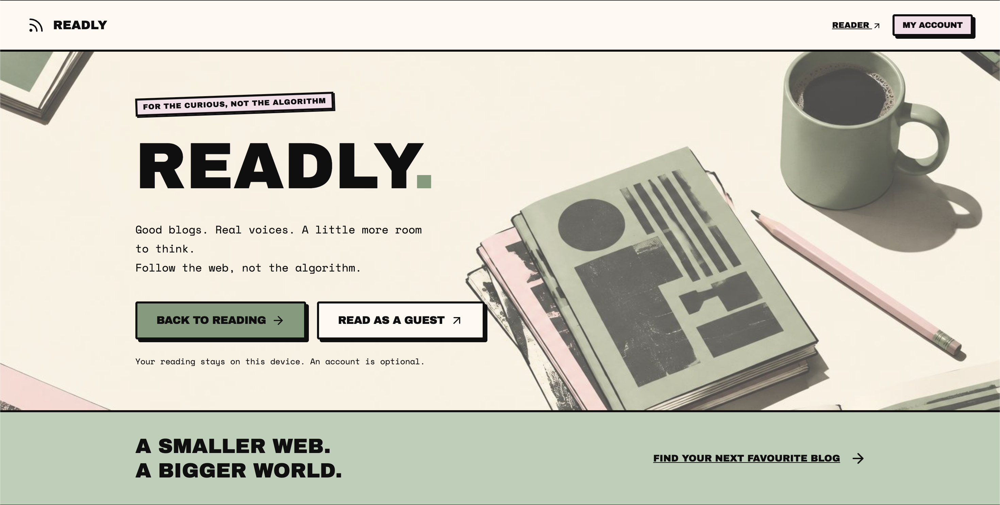
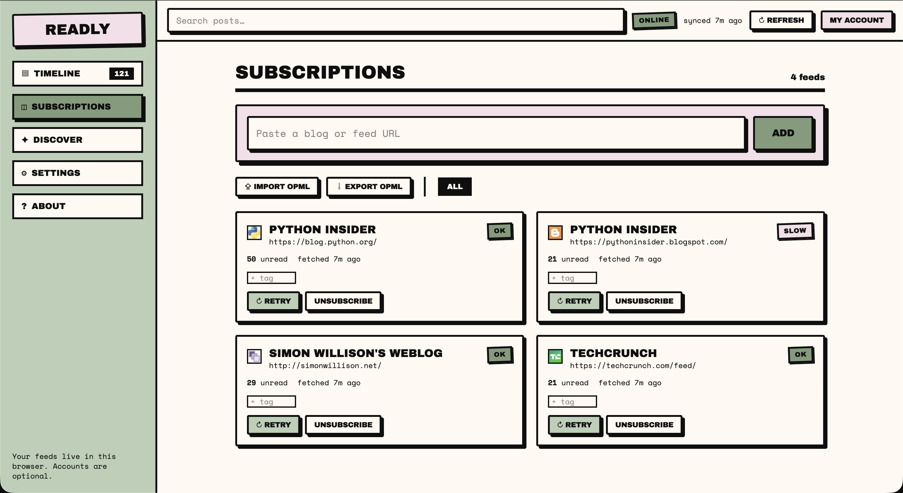
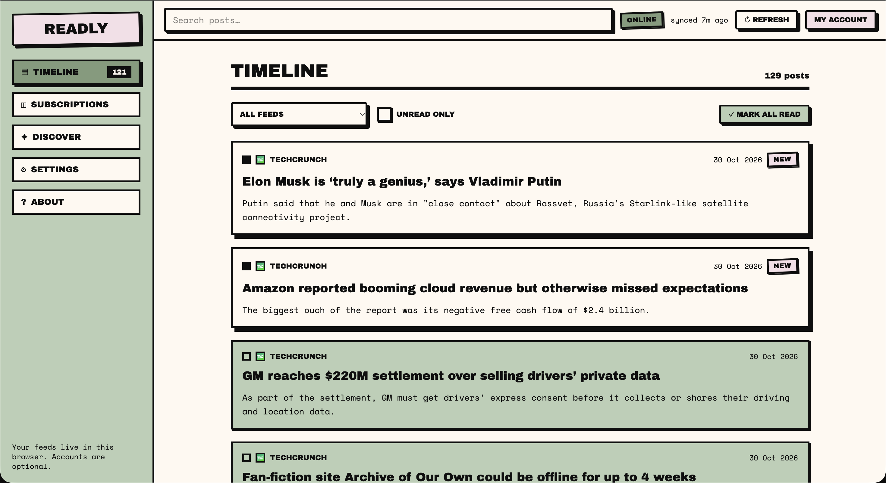
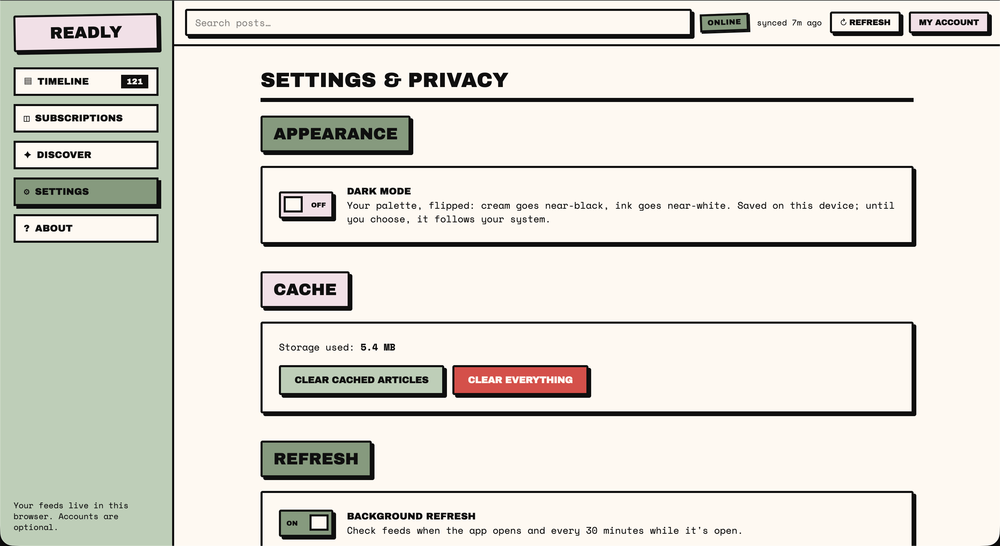
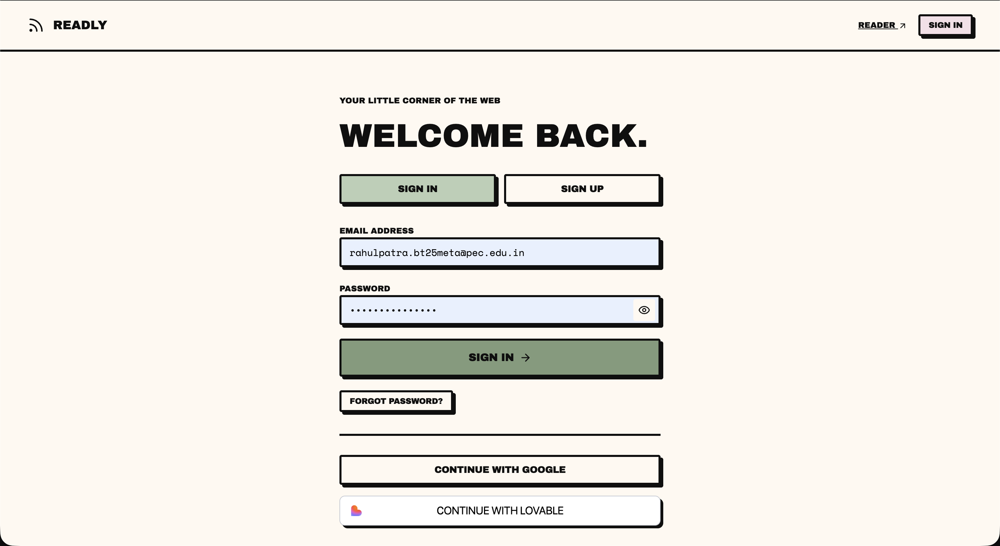
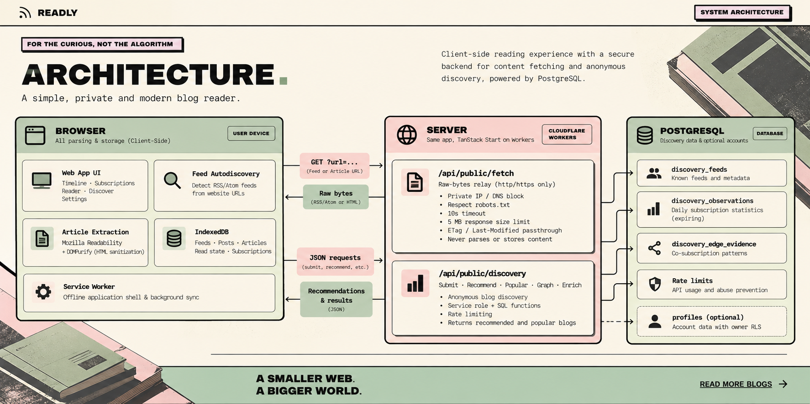

<div align="center">

# READLY

**A feed reader for the small web — with anonymous, opt-in blog discovery.**

RSS & Atom posts in one timeline · full articles saved offline · suggestions
explained, never invented

[Live demo](https://readly-01.lovable.app) ·
[Report a bug](https://github.com/PECathon-2026/Token-Titans/issues)


</div>



---

## READLY

Following independent blogs today means ten open tabs, an algorithm deciding what
you see, and a reading history that lives on someone else's server. READLY keeps
**reading local** — feeds, articles and read state stay in your browser — and makes
discovery **opt-in and anonymous**: you choose whether your feed list contributes to
the shared catalogue, and every suggestion explains the evidence behind it.

No likes, no follower counts, no invented popularity numbers. If an edge is demo
data, the UI says so.

### What you get

| | |
|---|---|
| **Read** | Unified timeline across RSS/Atom feeds, autodiscovery from any site URL, full-article extraction (Readability) with DOMPurify sanitising, per-feed tags, dead-feed detection |
| **Read offline** | Articles cached in IndexedDB and the app shell served by a service worker — open a saved post with Wi-Fi off |
| **Discover** | Community catalogue with transparent recommendations, a traversable "blogs like this" graph, and blogroll/XFN link evidence |
| **Control** | OPML import/export, background refresh every 30 min and on reconnect, dark mode, optional account that never uploads reading data |

| Product | Demo |
|---------|---------|
|  |  |
|  |  |

### Honest by design

- Recommendations only appear from **≥ 3 distinct daily observations** — no fabricated "followed by 388 readers".
- Sharing is **off by default**; turning it on sends normalised feed URLs (max 50) as one anonymous batch.
- Pre-seeded demo edges are flagged `demo = true` and labelled **"Demo dataset"** everywhere they appear.

---

## Quick start

```bash
bun install          # or: npm install
bun run dev          # http://localhost:8080
bunx vitest run      # 48 tests across 11 files
```

Production build:

```bash
bun run build && bun run preview
```

The service worker that makes the app work offline is **only registered in
production builds** (`src/lib/offline-sw.ts`), so the dev server never serves stale
code.

### Configuration

`.env` holds the browser-side values (publishable by design, safe to commit):

| Variable | Used by |
|---|---|
| `VITE_SUPABASE_URL`, `VITE_SUPABASE_PUBLISHABLE_KEY`, `VITE_SUPABASE_PROJECT_ID` | browser client — optional accounts |

Discovery routes additionally need a server-only privileged key. It is injected by
the hosting platform and **must never** be committed or exposed to the browser:

| Variable | Used by |
|---|---|
| `SUPABASE_URL`, `SUPABASE_SERVICE_ROLE_KEY` | `/api/public/discovery/*` routes only |

Reading, subscribing and offline articles work with **no account and no backend
key** — the discovery layer is the only part that needs one.

---

## Architecture



**The rule that shapes everything:** the server relays bytes and counts evidence.
It never stores article text, reading history or who read what. Parsing, extraction
and sanitising all happen in the browser, so a compromised feed cannot write
anything to the backend.

**Discovery ranking** combines popularity (submission counts) with co-subscription
and blogroll edges through the `guarded_recommendations` SQL function. Feeds you
already follow are never returned, and every result carries a `because` string
naming its strongest source — surfaced in the cards and in the graph view.

### Request lifecycle

1. You paste `simonwillison.net` → autodiscovery asks the relay for the homepage.
2. The relay checks `robots.txt`, blocks private/loopback addresses (including
   DNS-resolved and redirect targets), enforces a 10 s timeout and a 5 MB cap, and
   forwards `If-None-Match` / `If-Modified-Since` validators.
3. The browser parses RSS or Atom, extracts the full article with Readability,
   sanitises it with DOMPurify, and writes it to IndexedDB.
4. Upstream answers `304 Not Modified` on repeat visits — no bytes, no re-parsing.

---

## Privacy & threat model

**The backend stores:** normalised feed URLs, per-feed submission counts,
"A with B" and "A links to B" edges, daily salted IP hashes that expire after 24
hours, and — only if you create an account — an email and display name.

**The backend never stores:** article or post content, read state, reading history,
a subscription list tied to a person, raw IPs, or any persistent identifier.
Accounts never sync reading data; everything below works as a guest.

**Opt-in:** anonymous sharing is off by default. When turned on in Discover, the
client sends its feed URLs (max 50) as one anonymous batch.

### Defended against

| Threat | Control |
|---|---|
| SSRF | http(s) only; private/loopback IPs and DNS-resolved private hosts blocked; redirects re-checked; 10 s timeout; 5 MB cap |
| XSS from proxied content | every extracted document sanitised with DOMPurify in the browser; unsized inline SVGs clamped to 20 px |
| Ballot stuffing | 5 submissions per salted hash per day under an advisory lock; per-day network dedupe; batch downweighting `1 / max(1, n-1)`; edges need ≥ 3 distinct observations; weights capped |
| Duplicate URLs | one normaliser shared by client and server (scheme, `www`, trailing slash, tracking params) |
| Crawling against wishes | `robots.txt` enforced before fetching; denied sites are never bypassed |
| Prompt/HTML injection into the backend | the relay never parses or stores content; only homepage blogroll links are read server-side |

### Accepted risks

A determined attacker with many networks (Sybil) can still move ranking slowly;
daily hashes are not proof of distinct people, and no permanent tracking ID is
introduced to "fix" that. Remote sites may block the fetcher entirely. Both are
stated rather than papered over.

### Demo dataset

So Discover is not empty on first run, a small set of co-subscription edges is
pre-seeded with `demo = true`. They are always labelled **"Demo dataset"** in the
UI, ranked after real evidence, and never presented as real readers.

---

## Demo script

1. Open `/subscriptions` → **Add feed** → paste `simonwillison.net` (autodiscovery finds
   the Atom feed).
2. Open a post → the full article is extracted. Turn off Wi-Fi and reopen it → still
   readable.
3. Discover → enable **Anonymous sharing** → "Recommended for you" shows a blog with
   "Demo dataset: often followed with Simon Willison" → subscribe.
4. Open the graph below the list and follow a node from one blog to another.

### Edge cases worth showing

| Case | Try | Expected |
|---|---|---|
| No feed | `https://example.com` | "No feed found" message |
| Dead feed | `https://does-not-exist.invalid/feed` | feed marked dead in red, timeline unaffected |
| Robots-denied | `https://jvns.ca/atom.xml` (may deny) | clear error, no bypass |
| Too large | `https://danluu.com/atom.xml` | size-cap error, timeline unaffected |
| Extraction failure | any paywalled article | falls back to the feed summary |
| Duplicate URL | `http://www.simonwillison.net/atom/everything/?utm_source=x` | detected as already followed |
| Private IP | `http://127.0.0.1/feed` | blocked |

Also in the app: OPML import/export (Subscriptions), per-feed tags,
ETag/Last-Modified conditional fetch, background refresh every 30 minutes and on
reconnect, blogroll detection, and the "blogs like this" graph.

---

## Tech stack

1. **Frontend** — React 19, TypeScript, TanStack Start + Router, Tailwind CSS v4,
shadcn/ui on Radix, lucide-react, sonner.
2. **Reading pipeline** — `@mozilla/readability`, DOMPurify, `linkedom` (server-side
blogroll links only), IndexedDB via `idb`, `vite-plugin-pwa` (Workbox `generateSW`).
3. **Backend** — TanStack Start server routes on Cloudflare Workers, Lovable Cloud
(Supabase Postgres), RLS on `profiles`, SQL functions for evidence recording and
guarded ranking, email + Google + Lovable sign-in.
4. **Quality** — Vitest (48 tests), Playwright for offline and browser checks, ESLint +
Prettier.
5. **Design** — neo-brutalist system defined in `src/styles.css`: pink `#F6E0E6`, cream
`#FFF8F0`, sage `#B9CFB4` / `#7F9F7C`, ink `#111`; 3 px borders, hard shadows,
≤ 4 px radii; Archivo Black / Space Mono / Source Serif 4; dark mode is the
lightness inverse of the same palette.

---

## Contributing

Branch, commit, open a pull request — `bunx vitest run` must stay green. The
`AGENTS.md` file records the architecture rules (local-only reading data, shared URL
normalisation, the relay's SSRF contract) that any change has to keep.

## License

No license has been chosen yet; the code is published for judging and review.
Open an issue if you would like to use it elsewhere.

---

<div align="center">

**Pecathon 2026 · Team Token Titans**

Deepak Kumar · Rahul Patra · Lakshya Kashyap

[readly-01.lovable.app](https://readly-01.lovable.app)

</div>
